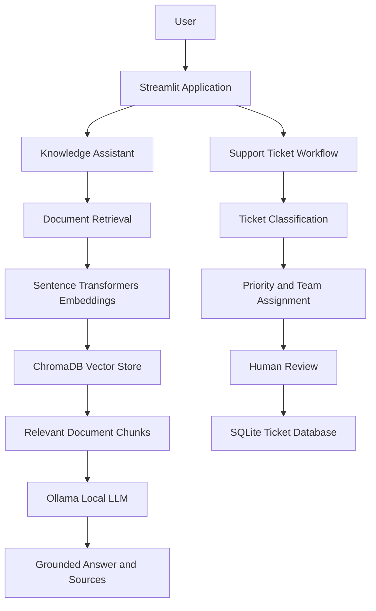

# Enterprise AI Knowledge & Workflow Assistant

A local LLM-powered AI assistant that answers questions from internal documentation using Retrieval-Augmented Generation (RAG) and helps automate IT support-ticket workflows.

## Overview

IT teams often spend time answering repetitive questions and manually categorizing support requests. This project combines a documentation-based question-answering system with an AI-assisted ticket workflow in a single Streamlit application.

The assistant retrieves relevant information from a local knowledge base, generates answers using a locally running language model, classifies support requests, and stores ticket records in SQLite. Ticket-management features support human review and workflow status updates.

The project is designed as a practical demonstration of RAG, local LLM integration, information retrieval, workflow automation, and database-backed application development.

## Features

- **Knowledge Assistant:** Ask questions about the available IT documentation.
- **Retrieval-Augmented Generation:** Retrieve relevant document chunks before generating an answer.
- **Local LLM Inference:** Generate responses using Ollama, without relying on a hosted LLM API for inference.
- **Document Ingestion:** Process supported TXT and PDF documents for the knowledge base.
- **Support-Ticket Classification:** Categorize requests and assign priority and a suggested team.
- **Ticket Workflow:** Create ticket drafts and manage ticket status through the application.
- **Human Review:** Review AI-generated responses before approval.
- **Persistent Storage:** Store support-ticket records in SQLite.
- **Automated Testing:** Test retrieval, classification, generation, database operations, and workflow behavior.

## Architecture



## Technology Stack

| Component | Technology |
|---|---|
| Programming language | Python |
| User interface | Streamlit |
| LLM runtime | Ollama |
| Language model | Llama 3.2 3B |
| RAG embeddings | Sentence Transformers |
| Vector database | ChromaDB |
| Relational database | SQLite |
| Document processing | PyMuPDF |
| Testing | pytest |
| Version control | Git and GitHub |

## Project Structure

```text
enterprise_ai_assistant/
├── app.py
├── ingest.py
├── src/
│   ├── agent.py
│   ├── database.py
│   ├── generator.py
│   ├── rag.py
│   └── workflow.py
├── data/
│   └── documents/
│       └── IT_Support_Guide.txt
├── tests/
│   ├── test_agent.py
│   ├── test_database.py
│   ├── test_generator.py
│   ├── test_retrieval.py
│   └── test_workflow.py
├── .gitignore
└── README.md
```

## Getting Started

### Prerequisites

Install the following before running the project:

- Python 3.12 recommended
- Git
- Ollama
- An Ollama-compatible model, such as `llama3.2:3b`

### 1. Clone the repository

```bash
git clone https://github.com/sahasomm-png/enterprise-ai-knowledge-workflow-assistant.git
cd enterprise-ai-knowledge-workflow-assistant
```

### 2. Create and activate a virtual environment

On macOS or Linux:

```bash
python3 -m venv .venv
source .venv/bin/activate
```

### 3. Install project dependencies

Install the Python packages used by the application:

```bash
python -m pip install streamlit pymupdf sentence-transformers chromadb ollama pytest
```

### 4. Install and start Ollama

Install Ollama from [ollama.com](https://ollama.com/).

Download the model:

```bash
ollama pull llama3.2:3b
```

Make sure the Ollama service is running and the model is available:

```bash
ollama list
```

### 5. Prepare the knowledge base

Run the document-ingestion script from the project root:

```bash
python ingest.py
```

This processes the documents configured for ingestion and builds the local vector database used for retrieval.

### 6. Start the application

```bash
streamlit run app.py
```

Open the local URL printed in the terminal by Streamlit, usually `http://localhost:8501`.

## Using the Application

### Knowledge Assistant

Ask a question about the content of the available documentation. The system retrieves relevant text and uses the local LLM to generate a response grounded in that context.

Example question:

> How do I reset my forgotten company password?

The included sample guide describes the password-reset process. Answers depend on the documents available in the knowledge base.

### Create Support Ticket

Submit a support request. The workflow classifies the request, estimates its priority, suggests a team, and prepares a ticket for review.

### Ticket Management

Review stored tickets, inspect generated responses, and use the available workflow controls to manage approval and status.

## Running Tests

Run the automated test suite from the project root:

```bash
pytest -q
```

The current development version passed **20 automated tests**. Results may vary if dependencies, code, or configuration change.

## Design Considerations

- **Local inference:** Ollama runs the language model locally, reducing dependence on hosted LLM APIs.
- **Grounded generation:** The RAG pipeline provides retrieved documentation as context for answering questions.
- **Human oversight:** AI-assisted support responses can be reviewed before approval.
- **Persistent records:** SQLite stores ticket information between application sessions.
- **Modular design:** Retrieval, generation, classification, database operations, and workflow logic are separated into modules.

## Current Limitations

- Answer quality depends on the relevance and completeness of the indexed documents.
- The included IT guide is a sample knowledge base, not a complete enterprise documentation collection.
- Ticket classification is a lightweight classification approach and may require further evaluation on real support data.
- Local inference performance depends on available hardware and model size.
- This project is a prototype; it is not yet integrated with a real enterprise ticketing platform or production identity-management system.

## Future Improvements

- Add a more comprehensive document evaluation pipeline.
- Improve retrieval relevance and answer-quality metrics.
- Add authentication and role-based access control.
- Integrate with an enterprise ticketing platform.
- Add audit logs, monitoring, and deployment automation.
- Expand automated evaluation with representative support questions.

## Author

**Sahasransu Nayak**

B.Tech in Data Science

GitHub: [@sahasomm-png](https://github.com/sahasomm-png)

## License

No license has been added yet. Unless a license is included, the repository should not be assumed to grant others permission to reuse, modify, or distribute the code.
